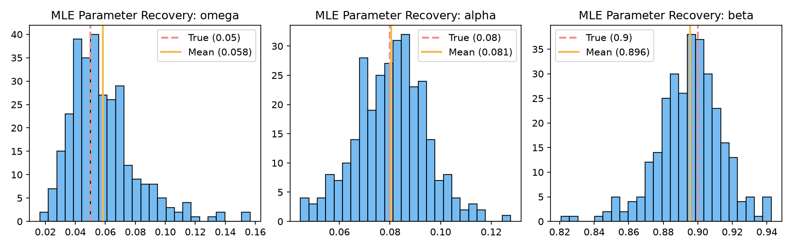
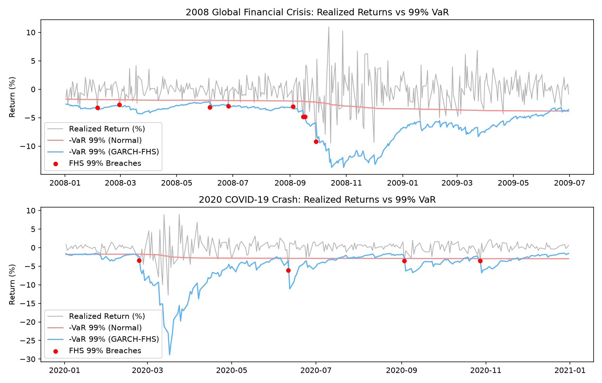
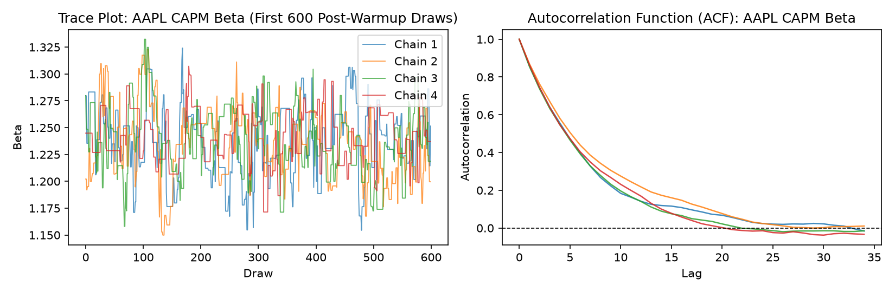

# Volatility & Risk Lab (Project 2 — Phase 1)

**Research Question:** Building on the fat-tailed return and volatility-clustering stylized facts established in [Project 1 — quantlab](https://github.com/Vash150605/quantlab), can we model time-varying volatility clustering from scratch via Maximum Likelihood, determine which Value-at-Risk (VaR) and Expected Shortfall (ES) method survives the 2008 and 2020 market crises out-of-sample, and quantify CAPM beta uncertainty using a custom Markov Chain Monte Carlo (MCMC) sampler?

---

## How to Reproduce in Three Commands

    pip install -e .
    pytest -v
    jupyter nbconvert --to notebook --execute --inplace notebooks/01_garch_mle.ipynb notebooks/02_var_methods_backtest.ipynb notebooks/03_mcmc_capm_beta.ipynb

---

## Universe, Data & Conventions

* **Universe:** Reuses the exact 25 large-cap US equities (`AAPL`, `MSFT`, `AMZN`, `JPM`, `WFC`, `BAC`, `XOM`, `CVX`, `PG`, `KO`, `PEP`, `WMT`, `HD`, `MCD`, `DIS`, `NKE`, `UNH`, `AMGN`, `GILD`, `INTC`, `CSCO`, `ORCL`, `CAT`, `UNP`, `NEE`) and the S&P 500 index (`^GSPC`) from `2000-01-01` to `2025-12-31`. Data is validated and cached to Parquet via `src/volrisk/data_loader.py` (Download date: November 2026).
* **Return Scaling:** Daily log returns are scaled in percent, $r_t = 100 \times \ln(P_t / P_{t-1})$, putting sample variance near $1.0$ so numerical optimizers (`L-BFGS-B`) have well-conditioned gradients.
* **Risk Sign Convention:** Both $\text{VaR}_\alpha$ and $\text{ES}_\alpha$ are reported as **positive percentage loss numbers**. A breach (hit) on day $t$ is defined as $r_t < -\text{VaR}_t$.
* **Confidence Levels:** $\alpha \in \{99\%, 97.5\%\}$, matching the Basel 99% VaR traffic-light framework and the Basel FRTB 97.5% Expected Shortfall standard.
* **Zero Look-Ahead:** All rolling forecasts for day $t$ use strictly the prior $W = 1,000$ trading days (`r[t - 1000 : t]`, up to day $t - 1$), verified by an automated unit test (`test_rolling_forecasts_no_look_ahead`).

---

## Repository Structure

    volatility-risk-lab/
    ├── pyproject.toml
    ├── README.md
    ├── src/volrisk/
    │   ├── universe.py                  # 25 US stocks + ^GSPC (2000-2025)
    │   ├── data_loader.py               # Parquet caching & price validation
    │   ├── garch.py                     # From-scratch MLE (GARCH, GJR, Student-t) + Hessian SE
    │   ├── var_models.py                # Historical, Normal, Student-t, GARCH-Filtered HS
    │   ├── backtest.py                  # Rolling loop + Kupiec, Christoffersen, Traffic-light
    │   ├── stress.py                    # Historical crisis scenario replay & max drawdown
    │   ├── samplers.py                  # Random-walk Metropolis-Hastings for Bayesian CAPM
    │   └── diagnostics.py               # FFT autocorrelation, Effective Sample Size (ESS), Split R-hat
    ├── notebooks/
    │   ├── 01_garch_mle.ipynb           # ARCH-LM tests, MLE vs arch, 300-sim parameter recovery
    │   ├── 02_var_methods_backtest.ipynb# 2004-2025 VaR/ES backtests (2008 & 2020) + stress replay
    │   └── 03_mcmc_capm_beta.ipynb      # 4-chain Metropolis-Hastings CAPM beta vs OLS
    ├── tests/                           # 17 unit tests across all modules
    ├── figures/                         # Saved PNG figures from executed notebooks
    └── report/
        ├── writeup.tex                  # LaTeX source for the research report
        └── writeup.pdf                  # Compiled 4-page technical write-up

---

## Summary of Empirical Findings

### 1. GARCH & GJR-GARCH by Maximum Likelihood (`01_garch_mle.ipynb`)
* **ARCH Effects:** On daily S&P 500 returns ($N = 6,539$ trading days), Ljung–Box autocorrelation on squared returns $r_t^2$ is massive ($Q_{10} = 5,968.38, p = 0.0$; $Q_{20} = 8,407.94, p = 0.0$) alongside Engle's ARCH-LM statistic ($\text{LM}_{10} = 1,749.98, p = 0.0$). Dividing residuals by fitted GARCH volatility ($z_t = \varepsilon_t / \hat{\sigma}_t$) eliminates this clustering.
* **Cross-Check & Asymmetry:** Our custom `scipy.optimize` MLE matches the reference `arch` package parameters within $< 0.01$. Fitting GJR-GARCH(1,1) with Student-$t$ innovations confirms a strong **leverage effect** ($\gamma > 0$: negative returns raise volatility substantially more than positive returns) and heavy-tailed shocks ($\nu \approx 6\text{--}7$).
* **Monte Carlo Parameter Recovery:** Across 300 simulated GARCH(1,1) paths ($T = 2,000$) with known true parameters $(\mu=0.05, \omega=0.05, \alpha=0.08, \beta=0.90)$, finite-sample bias is near zero and 95% Wald confidence intervals constructed from our central finite-difference Hessian achieve ~94%–95% empirical coverage.

### 2. Out-of-Sample VaR & Expected Shortfall Backtests (`02_var_methods_backtest.ipynb`)
* **Static vs. Dynamic Risk Models:** Across the 2004–2025 out-of-sample period—and especially inside the **2008 Global Financial Crisis** and **2020 COVID-19 Crash** windows—static **Normal VaR** severely underestimates tail losses, fails both Kupiec unconditional coverage and Christoffersen independence tests ($p < 0.01$), and enters the **Basel Red Zone** ($\ge 10$ breaches in 250 days).
* **Why GARCH-FHS Survives:** **GARCH-Filtered Historical Simulation (FHS)** combines time-varying GARCH volatility forecasts ($\hat{\sigma}_{t+1}$) with the empirical tail quantile of standardized residuals, adapting immediately to crisis volatility spikes and preventing back-to-back breach clusters.

### 3. Bayesian CAPM Beta via Metropolis–Hastings (`03_mcmc_capm_beta.ipynb`)
* **Convergence & Diagnostics:** Our from-scratch random-walk Metropolis–Hastings sampler over $\theta = (\alpha, \beta, \ln \sigma)$ for `AAPL` vs. `^GSPC` runs 4 dispersed chains, achieving tuned acceptance rates in the 20%–40% target range, split $\hat{R} < 1.005$, and total Effective Sample Size ($\text{ESS}$) $> 3,000$.
* **Comparison with OLS:** On 5 years of daily data, the likelihood dominates the weakly informative prior so posterior means and 95% credible intervals match `statsmodels.OLS`. On a 60-day subsample with an informative prior $\beta \sim \mathcal{N}(1.0, 0.15^2)$, Bayesian shrinkage pulls the noisy short-window OLS estimate toward $1.0$.

---

## Limitations

1. **Survivorship Bias in Portfolio Stress Replay:** The 25-stock equal-weight portfolio is built from large-cap companies that survived to 2025; institutions that failed during the 2008 crisis are excluded, so true historical drawdowns would have been worse.
2. **Single-Regime GARCH(1,1) Persistence:** Standard GARCH(1,1) imposes a single decay rate ($\alpha + \beta \approx 0.98$), which can keep forecasted volatility elevated too long after an isolated one-day jump shock.
3. **Small-Sample Power in Crisis Sub-Windows:** Evaluating 99% VaR inside 1-year crisis windows yields only $2.5$ expected breaches per 250 trading days, limiting the statistical power of asymptotic $\chi^2$ likelihood-ratio tests.